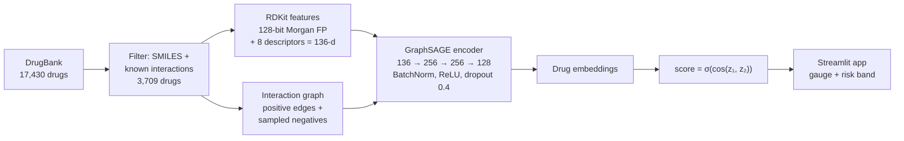

<div align="center">

# GNN Drug–Drug Interaction Predictor

**Link prediction on a DrugBank interaction graph with GraphSAGE and molecular fingerprints,<br>
served as an interactive Streamlit app.**

[](https://gnndrugdiscovery.streamlit.app)


[**Live demo**](https://gnndrugdiscovery.streamlit.app) · [Data audit](01_data_audit.ipynb) · [Negative sampling](02_negative_sampling.ipynb) · [Features](03_feature_engineering.ipynb) · [Training and evaluation](notebookb5d690712c.ipynb)

</div>

> [!WARNING]
> **Research use only.** This tool is not a clinical decision aid. Interaction scores are model outputs,
> not medical advice. Always consult a qualified healthcare professional.

---

## Overview

Drug–drug interactions (DDIs) are framed as **link prediction**: drugs are nodes, known interactions
are edges, and each node carries a 136-dimensional molecular feature vector computed from its SMILES
structure. A three-layer GraphSAGE encoder learns a 128-d embedding per drug, and the interaction
probability for a pair is the sigmoid of the cosine similarity of their embeddings.

The Streamlit app lets you pick any two of the 3,709 drugs and returns the predicted interaction
probability with a risk gauge.

## Highlights

- **Real-scale graph:** 3,709 drugs and 2.32M known interaction pairs, matched 1:1 with sampled negatives (~4.6M labelled pairs).
- **Chemistry-aware nodes:** 128-bit Morgan fingerprint + 8 molecular descriptors per drug (RDKit).
- **Baselines and ablations:** compared against logistic regression, random forest and a GAT; random, hard and mixed negative sampling; fingerprints-only vs full features; 5-fold cross-validation.
- **Deployable:** cached model loading, a Dockerfile for Hugging Face Spaces (port 7860), and a dev container.

## Results

Validation-set link-prediction results from [the training notebook](notebookb5d690712c.ipynb).

| Model | AUC-ROC |
|---|---|
| Logistic regression (baseline) | 0.656 |
| Random forest (baseline) | 0.742 |
| GAT | 0.616 |
| GraphSAGE, fingerprints only (128-d) | 0.869 |
| GraphSAGE, random negatives | 0.880 |
| **GraphSAGE, mixed negatives (30% hard + 70% random)** | **0.883** |
| GraphSAGE, 5-fold cross-validation | **0.897 ± 0.007** |

At an F1-optimised threshold (0.643), the random-negatives GraphSAGE model reaches **F1 0.816**,
precision 0.753 and recall 0.890 on the validation set. Training on hard negatives alone lowered AUC,
so the mixed strategy was kept.

## How it works



| Stage | Details |
|---|---|
| **Data audit** | 17,430 DrugBank entries; 12,313 have SMILES and 4,566 have recorded interactions; 3,710 have both |
| **Features** | RDKit parses 3,709 of them: 128-bit Morgan fingerprint + 8 molecular descriptors = 136-d per drug |
| **Negatives** | Random non-interacting pairs matched 1:1 with positives; hard and mixed (30% hard + 70% random) strategies compared |
| **Splits** | 70 / 15 / 15 train / validation / test |
| **Encoder** | `SAGEConv` × 3 (136 → 256 → 256 → 128), BatchNorm, ReLU, dropout 0.4 |
| **Decoder** | Sigmoid of the cosine similarity between L2-normalised drug embeddings |
| **Risk bands** | ≥ 0.75 high · 0.40–0.74 moderate · < 0.40 low |

## Getting started

### Run locally

```bash
git clone https://github.com/Aman-Tripathi27/gnn-ddi-app-.git
cd gnn-ddi-app-
python -m venv .venv && source .venv/bin/activate
pip install -r requirements.txt
streamlit run app.py
```

The trained weights (`best_sage_model.pt`), node features (`drug_features.npy`), index maps and the
cleaned DrugBank extract are committed, so the app runs without retraining.

### Run with Docker

```bash
docker build -t gnn-ddi .
docker run -p 7860:7860 gnn-ddi
```

Then open <http://localhost:7860>. The same image runs on Hugging Face Spaces (CPU Basic).

## Project structure

```text
gnn-ddi-app-/
├── app.py                          # Streamlit app: loads the graph, encodes drugs, scores pairs
├── 01_data_audit.ipynb             # DrugBank coverage: SMILES, interactions, usable drugs
├── 02_negative_sampling.ipynb      # negative pairs and train / val / test splits
├── 03_feature_engineering.ipynb    # Morgan fingerprints + molecular descriptors
├── notebookb5d690712c.ipynb        # training, baselines, ablations, cross-validation
├── best_sage_model.pt              # trained GraphSAGE weights
├── drug_features.npy               # 3,709 × 136 node features
├── drug_to_index.pkl, index_to_drug.pkl
├── drugbank_extracted_cleaned.csv  # drugs, SMILES, interactions, cleaned names
├── Dockerfile                      # Hugging Face Spaces image (port 7860)
├── .devcontainer/                  # Codespaces / VS Code dev container
└── requirements.txt
```

## Tech stack

| Area | Tools |
|---|---|
| Graph learning | PyTorch, PyTorch Geometric (`SAGEConv`) |
| Cheminformatics | RDKit (Morgan fingerprints, molecular descriptors) |
| Data | pandas, NumPy, scikit-learn |
| App | Streamlit, Plotly |
| Deployment | Streamlit Community Cloud, Docker / Hugging Face Spaces |

## Limitations

- **Transductive.** The model scores pairs among the 3,709 drugs in the graph; it cannot score a drug
  it has never seen.
- **Negatives are sampled, not confirmed.** A "negative" pair may be an interaction that DrugBank has
  not recorded yet, so precision is likely understated and some high scores may be real but unrecorded.
- **Edge-level splits.** The same drugs appear in training and evaluation, so the numbers measure how
  well missing links are recovered, not generalisation to new compounds.
- **Low-degree drugs are harder.** Drugs with few known interactions get less reliable scores.

## Data and licence

Drug structures and interactions come from [DrugBank](https://go.drugbank.com/), whose data is subject
to DrugBank's own licence terms. Check them before any reuse beyond research and education.

---

<div align="center">
<sub>Built by <a href="https://github.com/Aman-Tripathi27">Aman Tripathi</a> · <a href="https://amantripathii.netlify.app">Portfolio</a> · <a href="https://www.linkedin.com/in/aman-tripathi27/">LinkedIn</a></sub>
</div>
